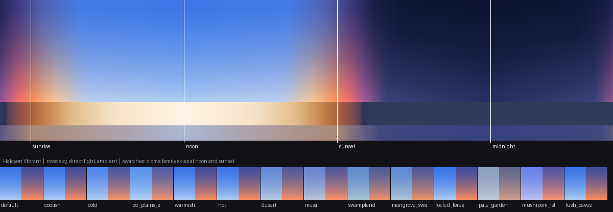

# Halcyon Visuals

A Vibrant Visuals resource pack for **Minecraft Bedrock 26.60+** aiming for the mood of Java's
best shader packs: saturated skies, long golden hours, readable blue nights, god rays,
living water and (next) per-block PBR. Pure official Vibrant Visuals data, so it runs on
every platform that has Vibrant Visuals.



## Presets
| Pack | Look |
|---|---|
| **Vibrant** | Saturated skies, golden hours, blue moonlit nights, god rays |
| **Cinematic** | ACES filmic contrast, deeper shadows, denser light shafts, darker nights |

## Install
1. Build (below) or download `Halcyon-*.mcpack` from the latest CI run's artifacts.
2. Open the `.mcpack` (Minecraft imports it), then activate it under **Settings → Global Resources**.
3. Turn on **Settings → Video → Graphics Mode → Vibrant Visuals**.

## Build
```bash
pip install pillow pytest
./tools/fetch_vanilla.sh          # pinned Mojang/bedrock-samples reference (no Mojang files are committed)
python -m pytest -q
python -m halcyon build           # → dist/Halcyon-<Preset>-v<version>.mcpack
python -m halcyon preview         # → docs/previews/<preset>.png (day-cycle render)
```

## How it works
`halcyon/style.py` holds the whole look (sun curves, sky colors, grading, fog, water, biome
families). The generator redefines every vanilla Vibrant Visuals identifier with that look,
validates every value against Mojang's documented ranges, and packages one `.mcpack` per
preset. Details: [`docs/design.md`](docs/design.md). Plan: [`ROADMAP.md`](ROADMAP.md).
